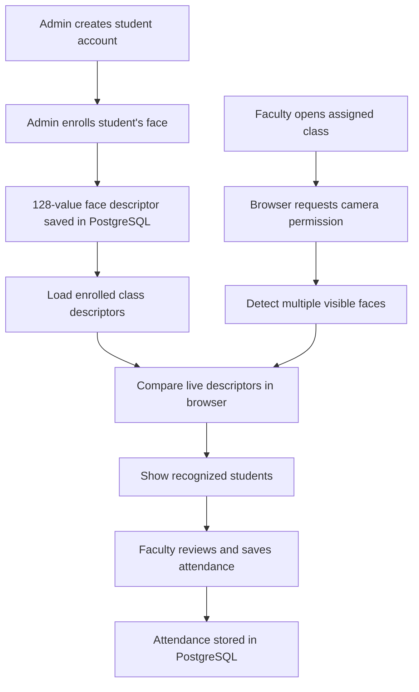
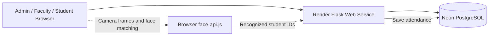

<div align="center">

# 🎓 Student Hub Attendance System

### Smart Academic Management · Faculty-Controlled Attendance · Browser-Based Face Recognition

[](https://student-hub-fresh.onrender.com/)
[](https://www.python.org/)
[](https://flask.palletsprojects.com/)
[](https://www.postgresql.org/)
[](https://render.com/)

**A web-based attendance platform for managing departments, faculty, students, class allocations and attendance — with a browser-based, multi-face classroom attendance prototype.**

</div>

---

## 🌐 Live Application

**Open the deployed application:**  
👉 https://student-hub-fresh.onrender.com/

The application is deployed as a Render Web Service and uses a PostgreSQL database hosted separately (Neon).

> **Demo note:** This is an actively developed academic project. The live service may take a short time to wake up on a free hosting plan. Face recognition requires students to be enrolled first, a supported browser, camera permission, suitable lighting and a camera view that can clearly see faces.

---

## ✨ Highlights

- 🔐 Separate Admin, Faculty and Student account workflows.
- 🏢 Department management.
- 👨‍🏫 Faculty account creation, password reset and removal.
- 🎓 Student account creation, student details, password reset and face enrollment.
- 📚 Subject creation and faculty/class allocation.
- 🧭 Admin view of current class allocations, including assigned faculty.
- ✏️ Edit class allocation details and reassign faculty.
- 🗑️ Delete an incorrect class allocation (associated attendance records for that class are also deleted).
- 📷 Browser-based face enrollment for existing student accounts.
- 👥 Whole-class camera page that can detect multiple visible faces in a frame and compare them with enrolled face descriptors.
- ✅ Faculty-controlled attendance save to PostgreSQL.
- 📊 Attendance report workflow.
- 🔑 Password hashing and protected Admin setup.

---

## 🧭 How the System Works

### 1. Admin workflow

1. Sign in as Admin.
2. Add departments.
3. Create Faculty accounts.
4. Create subjects and assign each class to a faculty member, semester and section.
5. Create Student accounts.
6. Open **Register / Update Face** for each student and complete face enrollment.
7. Review **Current Class Allocations** to see which faculty member is assigned to each class. Edit or delete allocations when needed.

### 2. Faculty workflow

1. Sign in using the Faculty account.
2. Open the assigned subject from the Faculty Dashboard.
3. Select **Start AI Face Attendance**.
4. Allow camera access when the browser asks.
5. Keep the classroom in view; the browser scans for multiple visible faces and compares them with enrolled student descriptors.
6. Stop the camera, review the recognized list and select **Save Attendance**.

### 3. Student workflow

Students use their Hub ID and password to sign in to the student area and view the student-facing information available in the application.

---

## 🧠 Face Recognition Flow

The current implementation uses face-api.js in the browser. Face descriptors are created during enrollment and stored in PostgreSQL; the classroom page loads the enrolled descriptors for the relevant class and performs matching in the browser.



### Face recognition considerations

- Enroll each student before attempting classroom recognition.
- Student department, semester and section must match the class allocation.
- Camera quality, camera angle, distance, lighting, occlusion and face size affect recognition.
- A single laptop webcam may not capture a large classroom clearly; a suitable wide-angle camera may be needed.
- The current face matching flow is an academic prototype, not a high-security biometric or liveness-detection system.
- Faculty should verify the recognized list before saving. Do not treat a missed detection as proof that a student is absent.
- Obtain informed consent and follow applicable institutional rules before collecting or processing face descriptors.

---

## 🖥️ Main Modules

| Module | Main capabilities |
|---|---|
| Admin Control Panel | Departments, faculty, students, subjects and class allocations |
| Faculty Dashboard | Assigned classes, attendance actions and reports |
| Student Area | Student sign-in and student-facing pages |
| Face Enrollment | Browser camera capture and descriptor storage |
| AI Attendance | Multi-face detection, matching and faculty-reviewed save |
| Attendance Reports | Class attendance records and reporting |

---

## 🛠️ Technology Stack

| Layer | Technology |
|---|---|
| Backend | Python, Flask |
| Web server | Gunicorn |
| Frontend | HTML, CSS, Bootstrap, JavaScript |
| Browser face recognition | face-api.js |
| Database | PostgreSQL |
| Database driver | psycopg 3 |
| Password security | Werkzeug password hashing |
| Hosting | Render |
| Database hosting | Neon PostgreSQL |

---

## 🏗️ Deployment Architecture



- **Web application:** Render
- **Database:** Neon PostgreSQL
- **Configuration:** Render environment variables
- **Camera processing:** Browser-side JavaScript

---

## 🚀 Run Locally

### Prerequisites

- Python 3.10 or newer
- PostgreSQL database
- Git
- Modern browser with camera access

### 1. Clone the repository

```bash
git clone https://github.com/Bunny-Kadari/Student-Hub-Attendance-System.git
cd Student-Hub-Attendance-System
git checkout fresh-postgres-admin-controlled
```

### 2. Create and activate a virtual environment

```bash
python3 -m venv .venv
source .venv/bin/activate
```

### 3. Install dependencies

```bash
pip install -r requirements.txt
```

### 4. Configure environment variables

Linux/macOS shell:

```bash
export DATABASE_URL="your-postgresql-connection-string"
export SECRET_KEY="your-long-random-secret"
export ADMIN_SETUP_TOKEN="your-private-one-time-setup-token"
```

Generate a strong secret key locally:

```bash
python3 -c "import secrets; print(secrets.token_urlsafe(48))"
```

Never commit real database URLs, passwords, secret keys or setup tokens to GitHub.

### 5. Start the application

```bash
python app.py
```

Open http://127.0.0.1:5001 in your browser.

> Browser camera access generally requires HTTPS or localhost. If camera access is blocked, check the browser's site permissions.

---

## ☁️ Render Deployment

1. Create a PostgreSQL database (for example, on Neon) and copy its connection string.
2. Create a Render Web Service from this GitHub repository.
3. Select branch: `fresh-postgres-admin-controlled`.
4. Set the build command:

   ```bash
   pip install -r requirements.txt
   ```

5. Set the start command:

   ```bash
   gunicorn --workers 2 --bind 0.0.0.0:$PORT app:app
   ```

6. Add these environment variables in Render:
   - `DATABASE_URL` — PostgreSQL connection string.
   - `SECRET_KEY` — long random secret.
   - `ADMIN_SETUP_TOKEN` — private initial setup token.
7. Deploy the service and open the live URL.
8. Complete the one-time Admin setup. The setup page closes after the first Admin account is created.

**Live service:** https://student-hub-fresh.onrender.com/

---

## 🔒 Security, Privacy & Operational Notes

- Passwords are stored as password hashes, not plain text.
- The first Admin is created through a setup flow protected by `ADMIN_SETUP_TOKEN`.
- Keep all environment secrets in Render settings; never put them in source code or README examples as real values.
- Face descriptors are biometric-related personal data. Collect them only with informed consent, restrict access, and provide an appropriate deletion/retention process for your institution.
- The current browser matching design is not protected against presentation attacks or spoofing and should not be used as the sole basis for high-stakes attendance decisions.
- Review the recognized list before saving attendance; camera misses and false matches are possible.
- Render free-tier local filesystem storage is not persistent. Uploaded student photos stored locally may be lost after restart or redeploy. Use durable object storage before relying on uploaded photos.
- Keep regular PostgreSQL backups. Deleting a class allocation also deletes its associated attendance rows through the configured database relationship.

---

## 🗺️ Roadmap

- [x] PostgreSQL-backed application deployment
- [x] Admin, Faculty and Student account flows
- [x] Department, subject and class setup
- [x] Admin class allocation overview
- [x] Edit and delete class allocations
- [x] Browser face enrollment for students
- [x] Browser multi-face classroom recognition prototype
- [x] Faculty-triggered attendance save
- [ ] Faculty review screen for present/absent corrections before final save
- [ ] Multiple enrollment samples per student to improve matching robustness
- [ ] Liveness / anti-spoofing checks and stronger authorization validation
- [ ] Persistent object storage for student photos
- [ ] Automated tests and deployment health monitoring
- [ ] Exportable attendance reports (CSV/PDF)

---

## 👨‍💻 Author

**Kadari Bunny**  
B.Tech — Computer Science and Engineering

**Project:** Student Hub Attendance System  
**Live Demo:** https://student-hub-fresh.onrender.com/

---

<div align="center">

⭐ If this project is useful or interesting, consider starring the repository.

**Built as an academic project to explore web development, database management and browser-based face recognition.**

</div>
